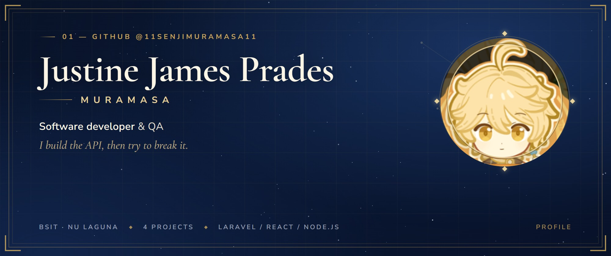
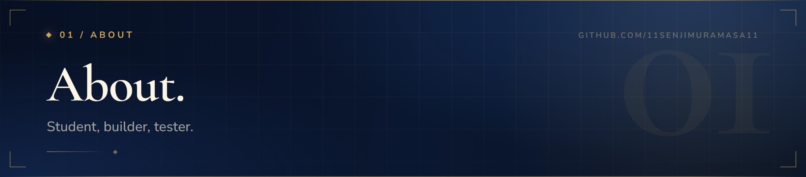
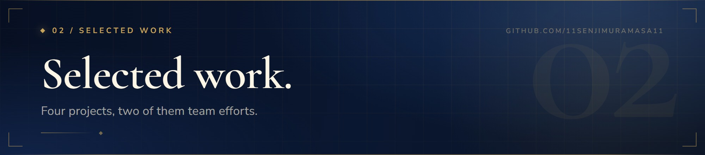
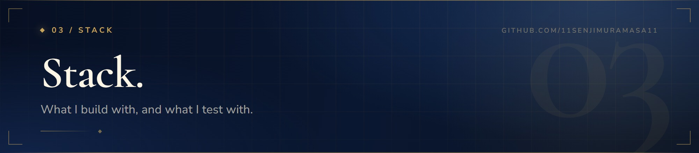
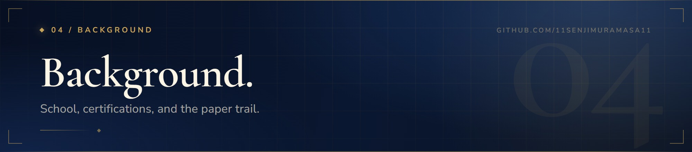
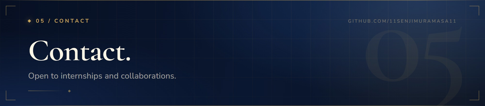

  

**Software developer & QA** · BSIT at NU Laguna

  
  
  
  

<table>
  <tr>
    <td width="840" valign="top">
      
I'm a BSIT student at National University (NU Laguna), building web
      applications in Laravel and React and testing them through full sprint
      cycles. I like the part where a system has to hold up: clear API
      contracts, role-based access, and a test plan that finds the gaps.

      
Right now I'm working through authentication, middleware, and validation
      — and getting better at reading someone else's code before changing it.

    </td>
  </tr>
</table>

<table>
  <tr>
    <td width="90" valign="top">
      <h3>01</h3>
      2026
    </td>
    <td width="750" valign="top">
      <h3><a href="https://github.com/11SenjiMuramasa11/Elective_song_API">Elective Song API</a></h3>
      
A music-streaming REST API for artists, albums, songs, and playlists, with
      search, charts, play counts, and playlist management. Built with a team.

      
<code>Node.js</code> <code>Express</code> <code>MySQL</code>

      
<strong>Built</strong> · <a href="https://github.com/11SenjiMuramasa11/Elective_song_API">Repository</a>

    </td>
  </tr>
</table>

<table>
  <tr>
    <td width="90" valign="top">
      <h3>02</h3>
      2026
    </td>
    <td width="750" valign="top">
      <h3><a href="https://github.com/11SenjiMuramasa11/github-11SenjiMuramasa11_firstapi">Student Records API</a></h3>
      
A compact CRUD API for student records, with JSON handling, status
      updates, and environment-based configuration.

      
<code>Node.js</code> <code>Express</code> <code>MySQL</code>

      
<strong>Built</strong> · <a href="https://github.com/11SenjiMuramasa11/github-11SenjiMuramasa11_firstapi">Repository</a>

    </td>
  </tr>
</table>

<table>
  <tr>
    <td width="90" valign="top">
      <h3>03</h3>
      2026
    </td>
    <td width="750" valign="top">
      <h3><a href="https://github.com/carilloandrei9264/team-idle">TrustHome PH</a></h3>
      
A rental marketplace capstone with document-reviewed listings,
      conflict-free booking, and a fairness-scored bank property catalog.
      Frontend work on settings, ratings, and trust scoring — then QA across five
      sprints: test plans, test cases, regression, and UAT.

      
<code>React</code> <code>Vite</code> <code>Firebase</code>

      
<strong>Contributor</strong> · <a href="https://github.com/carilloandrei9264/team-idle/pull/15">Pull request #15</a>

    </td>
  </tr>
</table>

<table>
  <tr>
    <td width="90" valign="top">
      <h3>04</h3>
      2025&#8209;26
    </td>
    <td width="750" valign="top">
      <h3><a href="https://github.com/AndreiCarillo-9264/manufacturing-coordination-system">cpcNextboard</a></h3>
      
An intranet system for real-time coordination between production,
      inventory, sales, and logistics at a manufacturing company. Co-developed
      with a team of three: Laravel and MySQL, live updates over WebSockets,
      role-based access, department dashboards, and a Groq-powered assistant for
      forecasting. Rated 4.12/5 by company staff and IT experts.

      
<code>Laravel</code> <code>PHP</code> <code>MySQL</code> <code>WebSockets</code>

      
<strong>Contributor</strong> · <a href="https://github.com/AndreiCarillo-9264/manufacturing-coordination-system/commit/4b3ed604daca984f0c1bf1991fbfbbab89e3dee5">Commit</a>

    </td>
  </tr>
</table>

<table>
  <tr>
    <td width="150" valign="top"><strong>Languages</strong></td>
    <td width="690" valign="top">
      
      
      
      
      
    </td>
  </tr>
  <tr>
    <td width="150" valign="top"><strong>Frameworks</strong></td>
    <td width="690" valign="top">
      
      
      
      
      
    </td>
  </tr>
  <tr>
    <td width="150" valign="top"><strong>Data & cloud</strong></td>
    <td width="690" valign="top">
      
      
      
      
    </td>
  </tr>
  <tr>
    <td width="150" valign="top"><strong>Integration</strong></td>
    <td width="690" valign="top">
      
      
      
    </td>
  </tr>
  <tr>
    <td width="150" valign="top"><strong>Tools</strong></td>
    <td width="690" valign="top">
      
      
      
      
      
    </td>
  </tr>
  <tr>
    <td width="150" valign="top"><strong>QA</strong></td>
    <td width="690" valign="top">
      
      
      
      
      
    </td>
  </tr>
</table>

Firebase: Firestore, Auth, Hosting, and Cloud Functions. AWS: EC2, S3, IAM, and
Route 53.

<table>
  <tr>
    <td width="130" valign="top"><strong>2022&nbsp;–&nbsp;now</strong></td>
    <td width="710" valign="top">BS Information Technology, National University (NU Laguna)</td>
  </tr>
  <tr>
    <td width="130" valign="top"><strong>2020&nbsp;–&nbsp;22</strong></td>
    <td width="710" valign="top">Senior High School, Laguna College of Business and Arts</td>
  </tr>
  <tr>
    <td width="130" valign="top"><strong>May&nbsp;2026</strong></td>
    <td width="710" valign="top">IT Specialist: Network Security — Certiport</td>
  </tr>
  <tr>
    <td width="130" valign="top"><strong>Mar&nbsp;2025</strong></td>
    <td width="710" valign="top">IT Specialist: Databases — Certiport</td>
  </tr>
  <tr>
    <td width="130" valign="top"><strong>Aug&nbsp;2025</strong></td>
    <td width="710" valign="top">Agentblazer Workshop — Salesforce Trailhead</td>
  </tr>
</table>

<table>
  <tr>
    <td width="130" valign="top"><strong>Email</strong></td>
    <td width="710" valign="top"><a href="mailto:justinejamesprades1111@gmail.com">justinejamesprades1111@gmail.com</a></td>
  </tr>
  <tr>
    <td width="130" valign="top"><strong>GitHub</strong></td>
    <td width="710" valign="top"><a href="https://github.com/11SenjiMuramasa11">@11SenjiMuramasa11</a></td>
  </tr>
  <tr>
    <td width="130" valign="top"><strong>LinkedIn</strong></td>
    <td width="710" valign="top"><a href="https://www.linkedin.com/in/jjprades">in/jjprades</a></td>
  </tr>
</table>

<strong>About this repository</strong> 
This is my GitHub profile repository, not a project. GitHub renders this
<code>README.md</code> at the top of <a href="https://github.com/11SenjiMuramasa11">my profile</a>.
The code lives in the repositories linked under Selected work.
