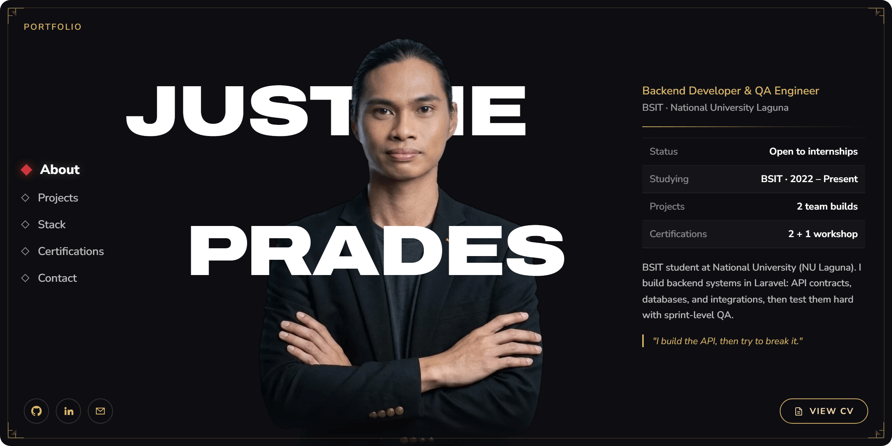
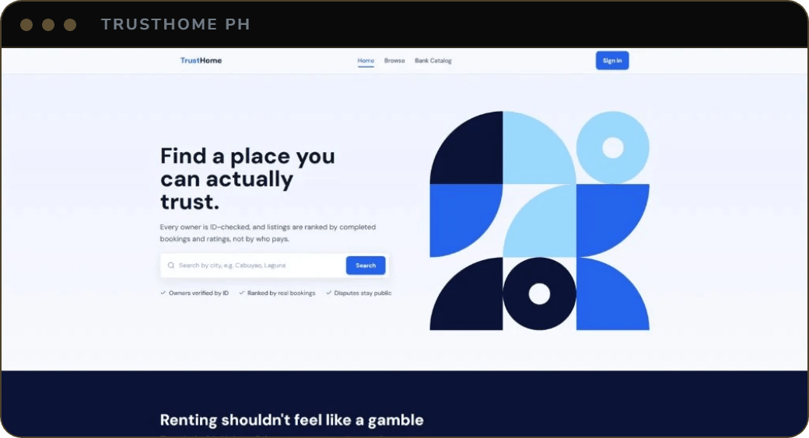
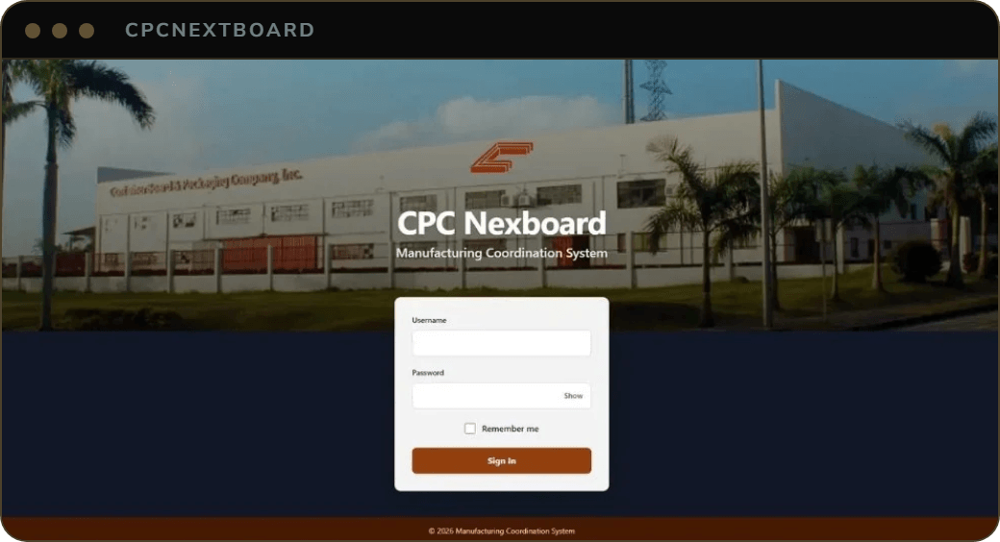
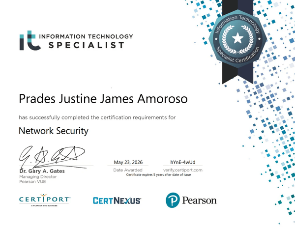

  

  
  
  
  

I'm a BSIT student at National University (NU Laguna), building web applications in Laravel and React and testing them through full sprint cycles. I like the part where a system has to hold up: clear API contracts, role-based access, and a test plan that finds the gaps.

Right now I'm working through authentication, middleware, and validation, and getting better at reading someone else's code before changing it.

<table>
  <tr>
    <td width="50%" valign="top">
      
      <h3><a href="https://11senjimuramasa11.github.io/11SenjiMuramasa11/#work">TrustHome PH</a></h3>
      
A rental marketplace where every owner is ID-checked and listings rank by completed bookings and ratings instead of paid placement. I worked on the settings, ratings and trust-score screens, then ran QA for five sprints: test plans, test cases, regression and UAT.

      
<code>React</code> <code>Vite</code> <code>Firebase</code>

      
Team capstone · Frontend and QA · <a href="https://github.com/carilloandrei9264/team-idle/pull/15">Pull request #15</a>

      
<a href="https://11senjimuramasa11.github.io/11SenjiMuramasa11/#work"><b>View TrustHome PH on my portfolio</b></a>

    </td>
    <td width="50%" valign="top">
      
      <h3><a href="https://11senjimuramasa11.github.io/11SenjiMuramasa11/#work">cpcNextboard</a></h3>
      
An intranet that keeps production, inventory, sales and logistics in step at a manufacturing company. Three of us built it in Laravel and MySQL, with live updates over WebSockets, role-based access, department dashboards and a Groq assistant for forecasting. Company staff and IT experts rated it 4.12 out of 5.

      
<code>Laravel</code> <code>PHP</code> <code>MySQL</code> <code>WebSockets</code> <code>Groq AI</code>

      
Team of three · Co-developer · <a href="https://github.com/AndreiCarillo-9264/manufacturing-coordination-system/commit/4b3ed604daca984f0c1bf1991fbfbbab89e3dee5">Commit 4b3ed60</a>

      
<a href="https://11senjimuramasa11.github.io/11SenjiMuramasa11/#work"><b>View cpcNextboard on my portfolio</b></a>

    </td>
  </tr>
</table>

**Backend** · `Laravel` `PHP` `Node.js` `Express` `REST APIs` `WebSockets` `EDI (ANSI X12)` `OAuth 2.0`

**Frontend** · `HTML5` `CSS3` `JavaScript` `TypeScript` `React` `Vite`

**Data** · `MySQL` `SQLite` `Firebase` `AWS`

**QA and tools** · `Git` `GitHub Actions` `Test Planning` `Test Cases & UAT` `PHPUnit` `ESLint`

<table>
  <tr>
    <td align="center" width="33%">
      
       <b>IT Specialist: Network Security</b>
       Certiport · Pearson VUE · May 2026
    </td>
    <td align="center" width="33%">
      
       <b>IT Specialist: Databases</b>
       Certiport · Pearson VUE · March 2025
    </td>
    <td align="center" width="33%">
      
       <b>Salesforce Agentblazer Workshop</b>
       Salesforce Trailhead · August 2025
    </td>
  </tr>
</table>

**Email** · [justinejamesprades1111@gmail.com](mailto:justinejamesprades1111@gmail.com)

**LinkedIn** · [linkedin.com/in/jjprades](https://www.linkedin.com/in/jjprades)

**Portfolio** · [11senjimuramasa11.github.io/11SenjiMuramasa11](https://11senjimuramasa11.github.io/11SenjiMuramasa11/)
