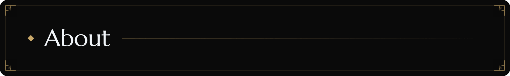
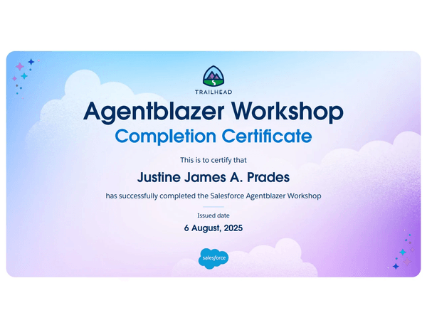

  

  
  
  
  

I'm a BSIT student at National University (NU Laguna), building web applications in Laravel and React and testing them through full sprint cycles. I like the part where a system has to hold up: clear API contracts, role-based access, and a test plan that finds the gaps.

Right now I'm working through authentication, middleware, and validation, and getting better at reading someone else's code before changing it.

| Project | Description | Stack | Role | Link |
| :-- | :-- | :-- | :-- | :-- |
| [**Elective Song API**](https://github.com/11SenjiMuramasa11/Elective_song_API) | A music-streaming REST API for artists, albums, songs, and playlists, built with a team. | `Node.js` `Express` `MySQL` | Built | [Repository](https://github.com/11SenjiMuramasa11/Elective_song_API) |
| [**Student Records API**](https://github.com/11SenjiMuramasa11/github-11SenjiMuramasa11_firstapi) | A compact CRUD API for student records. | `Node.js` `Express` `MySQL` | Built | [Repository](https://github.com/11SenjiMuramasa11/github-11SenjiMuramasa11_firstapi) |
| [**TrustHome PH**](https://github.com/carilloandrei9264/team-idle) | A rental marketplace capstone with document-reviewed listings and conflict-free booking. | `React` `Vite` `Firebase` | Contributor | [Pull request #15](https://github.com/carilloandrei9264/team-idle/pull/15) |
| [**cpcNextboard**](https://github.com/AndreiCarillo-9264/manufacturing-coordination-system) | An intranet system for real-time coordination between production, inventory, sales, and logistics at a manufacturing company. | `Laravel` `PHP` `MySQL` `WebSockets` | Contributor | [Commit](https://github.com/AndreiCarillo-9264/manufacturing-coordination-system/commit/4b3ed604daca984f0c1bf1991fbfbbab89e3dee5) |

**Backend** · `Laravel` `PHP` `Node.js` `Express` `REST APIs` `WebSockets` `EDI (ANSI X12)` `OAuth 2.0`

**Frontend** · `HTML5` `CSS3` `JavaScript` `TypeScript` `React` `Vite`

**Data** · `MySQL` `SQLite` `Firebase` `AWS`

**QA and tools** · `Git` `GitHub Actions` `Test Planning` `Test Cases & UAT` `PHPUnit` `ESLint`

<table>
  <tr>
    <td align="center" width="33%">
      
       <b>IT Specialist: Network Security</b>
       Certiport · Pearson VUE · May 2026
    </td>
    <td align="center" width="33%">
      
       <b>IT Specialist: Databases</b>
       Certiport · Pearson VUE · March 2025
    </td>
    <td align="center" width="33%">
      
       <b>Salesforce Agentblazer Workshop</b>
       Salesforce Trailhead · August 2025
    </td>
  </tr>
</table>

**Email** · [justinejamesprades1111@gmail.com](mailto:justinejamesprades1111@gmail.com)

**LinkedIn** · [linkedin.com/in/jjprades](https://www.linkedin.com/in/jjprades)

**Portfolio** · [11senjimuramasa11.github.io/11SenjiMuramasa11](https://11senjimuramasa11.github.io/11SenjiMuramasa11/)
